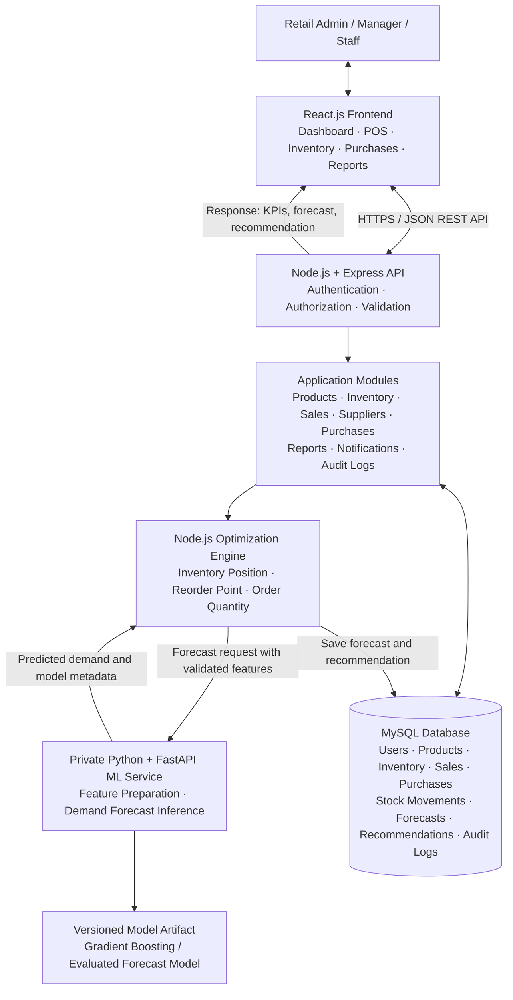
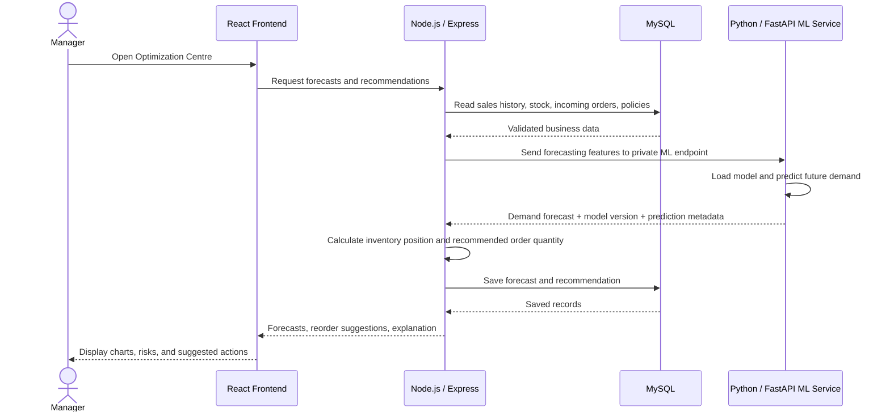
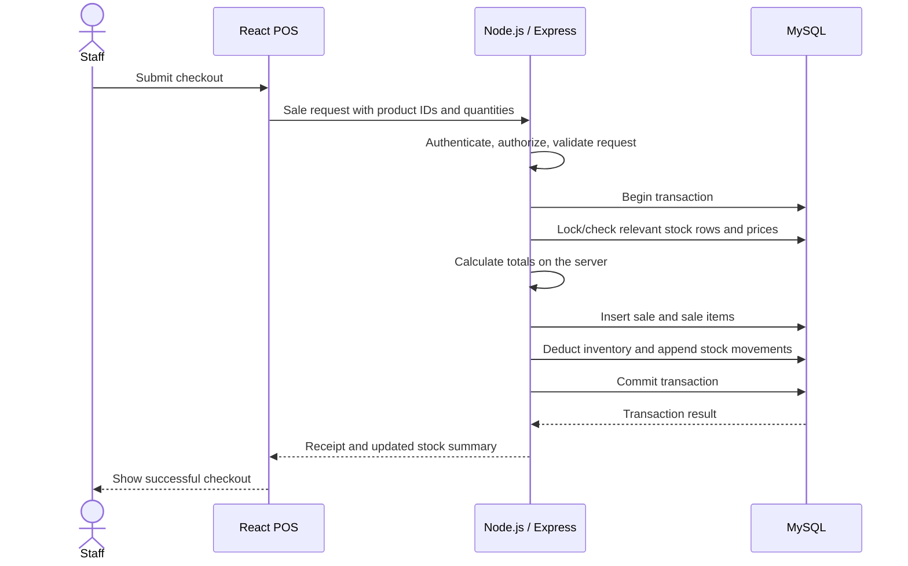

# ORIMS — System Architecture Diagram

**Project:** Optimised Retail Inventory Management System  
**Frontend:** React.js + JavaScript  
**Main backend:** Node.js + Express.js  
**Primary database:** MySQL  
**ML service:** Python + FastAPI + scikit-learn

## 1. High-level architecture

## 2. End-to-end demand forecast and replenishment flow

## 3. Sales transaction flow

If any transaction step fails, the backend must roll back all related writes. Use a safe concurrency strategy and an idempotency key to prevent overselling or duplicate checkout processing.

## 4. Architecture boundaries and rules

1. **React is the presentation layer.** It must not connect directly to MySQL or call the ML service directly.
2. **Node.js is the main application backend and source of business rules.** It owns authentication, role checks, sales, purchases, inventory transactions, and recommendation logic.
3. **MySQL is the source of truth for business records.** Successful stock changes update the inventory balance and append a stock movement in the same transaction.
4. **Python/FastAPI is a private ML inference service.** It predicts demand from prepared inputs; it does not own sales, stock, or purchase-order transactions.
5. **Node.js sends only the necessary validated forecasting features to the ML service.** It receives predictions, then applies retail constraints and saves forecasts/recommendations in MySQL.
6. **Training is separate from online inference.** A controlled training/evaluation process creates versioned model artifacts. Do not train a model on every user request.
7. **Recommendations are advisory by default.** A manager reviews the proposed quantity before a purchase order is created.
8. **Service failure must be handled gracefully.** If ML is unavailable, show the last valid forecast when appropriate or use a clearly labeled baseline fallback. Never represent a fallback as a fresh ML prediction.
9. **Security boundary:** expose the React-facing Express API publicly as required; keep the ML service private to the backend/network. Protect secrets through environment configuration.
10. **Use explicit model metadata.** Store model version, training period, forecast horizon, and evaluation metrics alongside predictions.

## 5. Principal data domains

- **Identity and access:** users, roles, sessions/tokens, audit logs.
- **Catalogue:** products, categories, supplier-product mappings.
- **Inventory:** stores, stock balances, stock movements, batches and expiry (if enabled).
- **Sales:** sales, sale items, returns.
- **Purchasing:** suppliers, purchase orders, purchase-order items, receiving records.
- **Optimization:** inventory policies, forecasts, model versions, forecast evaluations, recommendations.
- **Operations:** notifications, audit events, health checks, logs and backups.

## 6. Deployment view

For local development, run the React frontend, Express backend, Python ML service, and MySQL as separate processes or containers. In production, deploy the frontend and backend with HTTPS, keep the ML service on a private network, use managed or secured MySQL, and configure backups, health checks, structured logs, secrets, and environment-specific settings.

## 7. Source of truth

This diagram expresses the selected architecture: **React + Node.js/Express + MySQL + a separate Python/FastAPI/scikit-learn ML service**. If any other project document conflicts with this diagram, resolve the conflict in the project decision log before implementing the differing behavior.
